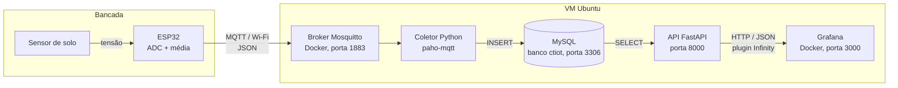

# projeto-iot-gustavos — Monitor de umidade do solo

Projeto individual do curso **CTIoT**. Acompanha a umidade da terra de um vaso ou canteiro e indica quando ela está **secando** e precisa de rega.

Um sensor de umidade do solo ligado a um ESP32 publica as leituras por MQTT. Um servidor em Python recebe e grava os dados num banco MySQL. Uma API REST (FastAPI) disponibiliza esses dados, e um dashboard no Grafana os mostra em tempo real e em gráficos históricos.

> Itens marcados com **⏳ a definir** ainda dependem de etapas futuras do projeto e serão preenchidos ao longo das semanas.

---

## Sumário

1. [Identificação](#1-identificação)
2. [Requisitos](#2-requisitos)
3. [Arquitetura](#3-arquitetura)
4. [Lista de materiais](#4-lista-de-materiais)
5. [Esquema de ligação e decisões de hardware](#5-esquema-de-ligação-e-decisões-de-hardware)
6. [Calibração e percentual relativo](#6-calibração-e-percentual-relativo)
7. [Faixas e critério de secagem](#7-faixas-e-critério-de-secagem)
8. [MQTT: tópicos e payload](#8-mqtt-tópicos-e-payload)
9. [Banco de dados](#9-banco-de-dados)
10. [API REST](#10-api-rest)
11. [Dashboard no Grafana](#11-dashboard-no-grafana)
12. [Estrutura do repositório](#12-estrutura-do-repositório)
13. [Como executar](#13-como-executar)
14. [Decisões técnicas](#14-decisões-técnicas)
15. [Testes](#15-testes)
16. [Problemas encontrados](#16-problemas-encontrados)
17. [Marcos de entrega](#17-marcos-de-entrega)

---

## 1. Identificação

| Item | Valor |
|---|---|
| Identificador do aluno | `gustavos` |
| Nome do dispositivo / client ID MQTT | `esp32-gustavos` |
| Código do projeto | `solo` |
| Repositório | `projeto-iot-gustavos` |
| Usuários do broker | `esp-gustavos` (ESP32), `leitor-gustavos` (coletor), `admin-gustavos` (testes manuais) |

---

## 2. Requisitos

| # | Requisito | Status |
|---|---|---|
| R1 | O ESP32 lê o sensor por uma entrada analógica, com média de várias amostras | ✅ média de 20 amostras (ver [Teste de bancada 1](#testes-de-bancada-semana-1)) |
| R2 | A leitura é calibrada (seco e molhado) e vira o percentual relativo `solo_pct` | 🟡 calibrado; o ponto "seco" ainda é provisório |
| R3 | Publica `solo_bruto` e `solo_pct` a cada **60 s**; reconecta sozinho; status com Last Will | 🟡 Wi-Fi, MQTT e Last Will prontos; falta a publicação dos dados |
| R4 | O broker roda em container, sem acesso anônimo, com senhas com hash e ACL por usuário | ⏳ |
| R5 | O coletor valida e grava as duas grandezas | ⏳ |
| R6 | A API oferece os quatro endpoints padrão e o endpoint de **secagem** | ⏳ |
| R7 | O Grafana mostra o percentual com as faixas seco/ideal/encharcado, o gráfico de 24 h e o indicador "secando" | ⏳ |
| R8 | O plano de testes é executado, incluindo um ciclo real de rega e secagem | ⏳ |

**Opcionais** (depois do obrigatório): taxa de secagem por hora; previsão de quando o solo chega ao seco; gráfico de vários dias com as regas destacadas; serviços do systemd; TLS no broker.

---

## 3. Arquitetura

Uma leitura atravessa sete peças, da bancada ao Grafana:



| Camada | Responsabilidade única |
|---|---|
| Firmware (ESP32) | Medir e publicar |
| Broker (Mosquitto) | Entregar mensagens |
| Coletor (Python) | Validar e guardar |
| MySQL | Lembrar (histórico) |
| API (FastAPI) | Responder perguntas sobre os dados |
| Dashboard (Grafana) | Mostrar |

Como cada camada tem uma só responsabilidade, dá para testar cada uma isoladamente (o ESP publica? o coletor recebe? o banco tem a linha? a API responde? o Grafana mostra?) e localizar onde está um problema.

---

## 4. Lista de materiais

| Qtd. | Item | Observação |
|---|---|---|
| 1 | ESP32 DevKit (`esp32dev`) | Alimentado pela USB |
| 2 | Sensor de umidade do solo **resistivo** (garfo + módulo com saídas AO/DO) | Dois sensores, A e B, usados nos testes de bancada |
| — | Jumpers / protoboard | |
| 1 | Vaso com terra | ⏳ tipo de solo e profundidade a registrar |

---

## 5. Esquema de ligação e decisões de hardware

### Ligação

| Sensor | Pino do módulo | Pino do ESP32 |
|---|---|---|
| A | VCC | GPIO 23 (alimentação chaveada) |
| A | GND | GND |
| A | AO | GPIO 34 |
| A | DO | não conectado |
| B | VCC | GPIO 23 (alimentação chaveada) |
| B | GND | GND |
| B | AO | GPIO 35 |
| B | DO | não conectado |

ADC configurado com resolução de 12 bits (0 a 4095) e atenuação de 11 dB.

> ⏳ Esquema desenhado e foto da montagem: a adicionar em `docs/`.

### Por que cada escolha

1. **Alimentar o sensor com 3,3 V, e não com 5 V.**
   O módulo funciona de 3,3 V a 5 V. A saída AO nunca passa da tensão de alimentação. Com 5 V, ela poderia chegar a 5 V, acima dos ~3,3 V que o pino do ESP32 aceita, e isso danificaria o ESP32. Com 3,3 V, a saída fica sempre dentro do limite seguro.

2. **Usar só a saída AO e deixar a DO desligada.**
   A DO só diz "seco" ou "molhado", conforme o potenciômetro. O projeto precisa de um valor contínuo para calcular o percentual, e esse valor vem da AO.

3. **Ler pelos GPIO 34 e 35.**
   Esses pinos pertencem ao ADC1. O ADC2 do ESP32 não pode ser usado enquanto o Wi-Fi está ligado, então os sensores precisam ficar no ADC1.

4. **Alimentar o sensor por um pino (GPIO 23), e não direto no 3V3.**
   É a resposta para "como reduzir a corrosão?". Com corrente passando o tempo todo, as hastes sofrem eletrólise e corroem em poucas semanas. Como a leitura é feita a cada 60 s, o ESP32 liga o sensor só durante a leitura, por alguns milissegundos (20 ms para estabilizar + amostragem), e desliga em seguida. Assim a haste fica sem corrente mais de 99 % do tempo. O módulo consome poucos miliamperes, e um pino do ESP32 fornece isso sem problema.

5. **O que não pode molhar:** a placa pequena (módulo) e as conexões dos fios no garfo. Só a parte das hastes vai na terra. A placa fica acima do vaso, longe dos respingos da rega.

> ⏳ **Por que resistivo e não capacitivo:** justificar a escolha (durabilidade e corrosão).

---

## 6. Calibração e percentual relativo

### Por que o percentual é relativo

A leitura do sensor depende do tipo de solo, da compactação e da profundidade. Por isso `solo_pct` **não é umidade volumétrica**: é um percentual relativo (0 a 100 %) entre dois pontos medidos no próprio solo — **seco** (0 %) e **molhado** (100 %).

### Fórmula

Neste sensor o valor bruto **cai** quando a umidade sobe. Por isso a subtração é feita na ordem `seco − bruto`, e não `bruto − seco`, o que "inverte" o sentido do sensor:

```
solo_pct = (seco − bruto) / (seco − molhado) × 100      (limitado entre 0 e 100)
```

Exemplo com o sensor B (seco = 4095, molhado = 1380, denominador = 2715):

| Situação | Bruto | Cálculo | Resultado |
|---|---|---|---|
| Seco | 4095 | (4095 − 4095) / 2715 × 100 | 0 % |
| Terra "molhada" da 1ª medição | 2965 | (4095 − 2965) / 2715 × 100 | ≈ 42 % |
| Bem molhada | 1380 | (4095 − 1380) / 2715 × 100 | 100 % |

Quanto mais o bruto cai, maior fica o numerador e mais o percentual sobe.

### Procedimento

- **100 % (molhado):** regar até a água escorrer pelo fundo do vaso e esperar 10 minutos antes de medir. O procedimento precisa ser sempre o mesmo, porque a leitura muda muito conforme o quanto a terra está molhada (ver [Teste de bancada 2](#testes-de-bancada-semana-1)).
- **0 % (seco):** ⏳ medir com terra seca.

### Valores atuais

Medidos em **16/11/2026**. Tipo de solo e profundidade: ⏳ a registrar.

| Sensor | Seco (0 %) | Molhado (100 %) |
|---|---|---|
| A | 4095 *(provisório)* | 1412 |
| B | 4095 *(provisório)* | 1380 |

> **Seco provisório:** foi usado 4095 (fundo de escala do ADC) porque não havia terra seca no momento da calibração. Deve ser confirmado com terra seca.
>
> ⚠️ O valor molhado do sensor A está anotado como **1412**, mas no firmware (`CAL_A_MOLHADO`) está **1410**. Conferir qual é o correto.

---

## 7. Faixas e critério de secagem

| Faixa | Limites de `solo_pct` | Cor no medidor |
|---|---|---|
| Seco | ⏳ a definir | ⏳ |
| Ideal | ⏳ a definir | ⏳ |
| Encharcado | ⏳ a definir | ⏳ |

**Critério de "secando":** ⏳ a definir. Deve ser baseado em **médias por hora**, e não em leituras isoladas: o endpoint `/secagem` compara a média da última hora com a da hora anterior e responde `1` (secando) ou `0` (estável), junto com a variação.

**Diferença entre solo seco e sensor fora da terra:** ⏳ a documentar (teste 3).

---

## 8. MQTT: tópicos e payload

| Tópico | Conteúdo | Retida? | Quem publica |
|---|---|---|---|
| `inatel/gustavos/dados` | Leituras em JSON | Não | ESP32, a cada 60 s |
| `inatel/gustavos/status` | `online` ou `offline` | Sim | ESP32 ao conectar (`online`); o broker, pelo Last Will, se o ESP cair (`offline`) |

As leituras são publicadas com **QoS 0** (a PubSubClient só publica em QoS 0, e a perda eventual de uma leitura periódica não compromete o histórico).

Payload:

```json
{
  "dispositivo": "esp32-gustavos",
  "projeto": "solo",
  "leituras": {
    "solo_bruto": 1850,
    "solo_pct": 62.0
  }
}
```

| Grandeza | Unidade | Faixa válida (o coletor descarta fora dela) |
|---|---|---|
| `solo_bruto` | contagem do ADC | 0 a 4095 |
| `solo_pct` | % relativo | 0 a 100 |

O payload não tem data/hora: o ESP32 não tem relógio confiável, então o **servidor registra o horário** em que recebeu a mensagem.

---

## 9. Banco de dados

MySQL na VM, banco `ctiot`, acessado pelo usuário `ctiot_app` (com permissão só sobre `ctiot`, nunca `root`). O MySQL fica acessível apenas dentro da VM.

Tabelas (esquema padrão, em `banco/schema.sql`):

- `dispositivos` — `id`, `nome`, `projeto`, `criado_em`
- `leituras` — `id`, `dispositivo_id`, `grandeza`, `valor`, `recebido_em` (uma linha por grandeza; cada mensagem gera duas linhas)

Consultas em `banco/consultas.sql` (todas parametrizadas):

- ⏳ **Secagem:** média de `solo_pct` em cada hora das últimas 48 h e variação em relação à hora anterior (funções de janela / `LAG`).
- ⏳ Última leitura.
- ⏳ Menor e maior percentual de cada dia da semana.
- ⏳ Horários das regas (variação acima de +10 pontos).

---

## 10. API REST

FastAPI na porta **8000**, respostas em JSON, horários em ISO 8601 com fuso (ex.: `2026-11-04T15:20:31-03:00`). Documentação automática em `/docs`.

| Método e caminho | Devolve | Uso no Grafana |
|---|---|---|
| `GET /api/dispositivos` | Lista de dispositivos cadastrados | Conferência |
| `GET /api/dispositivos/{nome}/ultima` | Última leitura de cada grandeza, com horário e `idade_s` | Valor atual e aviso de "sem dados" |
| `GET /api/dispositivos/{nome}/leituras?grandeza=solo_pct&horas=24` | Pares horário/valor no período | Gráfico de 24 h |
| `GET /api/dispositivos/{nome}/resumo?horas=24` | Mínimo, máximo, média e quantidade por grandeza | Resumo |
| `GET /api/dispositivos/{nome}/secagem` | `1` (secando) ou `0`, com a variação entre a última hora e a anterior | Indicador "secando" |

Regras: `horas` entre 1 e 168 (fora disso, **422**); dispositivo inexistente, **404**.

⏳ Comportamento quando ainda não há duas horas de dados: a definir.

---

## 11. Dashboard no Grafana

Grafana em container (`grafana/docker-compose.yml`, versão fixada, porta 3000, volume persistente, reinício automático, plugin Infinity instalado pelo compose, senha do administrador em `.env` fora do Git). Lê os dados **só da API**, nunca do banco.

Painéis:

- **Medidor** de `solo_pct` (0 a 100) com as faixas seco / ideal / encharcado nas cores da [seção 7](#7-faixas-e-critério-de-secagem).
- **Indicador "secando"** a partir de `/secagem`.
- **Gráfico de 24 h** de `solo_pct`.
- **Resumo** (mínimo, máximo, média).
- **Aviso de "sem dados"** a partir de `idade_s`, vermelho depois de **3 minutos** (três intervalos de publicação de 60 s).
- Atualização automática a cada 5 s.

Dashboard exportado em `grafana/dashboard.json`.

> ⏳ Prints do dashboard: a adicionar em `docs/`.

---

## 12. Estrutura do repositório

```
projeto-iot-gustavos/
├── firmware/                ← projeto PlatformIO do ESP32
│   ├── platformio.ini
│   ├── src/main.cpp
│   └── include/secrets.example.h
├── broker/                  ← Mosquitto em Docker            ⏳
│   ├── docker-compose.yml
│   ├── mosquitto.conf
│   ├── acl                  ← permissões de cada usuário
│   └── passwd.example       ← lista dos usuários, sem senhas
├── banco/                                                     ⏳
│   ├── schema.sql           ← criação das tabelas
│   └── consultas.sql        ← consultas usadas e testadas
├── servidor/                                                  ⏳
│   ├── db.py                ← conexão com o banco
│   ├── coletor.py           ← subscriber MQTT que grava no banco
│   ├── api.py               ← API FastAPI
│   ├── requirements.txt
│   └── .env.example
├── grafana/                 ← Grafana em Docker               ⏳
│   ├── docker-compose.yml
│   ├── .env.example
│   └── dashboard.json
├── docs/                    ← esquema, fotos, prints, plano de testes
├── .gitignore
└── README.md
```

**Credenciais fora do Git:** `firmware/include/secrets.h`, `servidor/.env`, `grafana/.env` e `broker/passwd` estão no `.gitignore`, com arquivos de exemplo no lugar. As pastas de dados dos containers (`broker/data/`, `broker/log/`, `grafana/data/`) também.

---

## 13. Como executar

### Firmware (ESP32)

1. Abrir a pasta `firmware/` no VS Code com a extensão PlatformIO.
2. Copiar `include/secrets.example.h` para `include/secrets.h` e preencher Wi-Fi e credenciais do broker (`esp-gustavos`).
3. Compilar e gravar (*Upload*), depois abrir o monitor serial a **115200** baud.

### Broker, coletor, banco, API e Grafana

⏳ A documentar conforme cada etapa for concluída.

---

## 14. Decisões técnicas

| Decisão | Motivo |
|---|---|
| Arduino framework no PlatformIO | Bibliotecas maduras; mais simples que ESP-IDF puro para começar |
| PubSubClient (+ ArduinoJson) | Bibliotecas mais usadas e documentadas para MQTT e JSON no ESP32 |
| Laço principal sem `delay()` longo, usando `millis()` | O laço nunca fica bloqueado: Wi-Fi, MQTT e leitura convivem |
| Reconexão do Wi-Fi feita pelo próprio firmware (a cada 10 s) e do MQTT a cada 5 s | Controle explícito de cada parte da rede, provada separadamente |
| Last Will `offline` retido em `inatel/gustavos/status` | O broker avisa sozinho quando o ESP cai |
| Média de 20 amostras por leitura | Reduz o ruído do ADC do ESP32 (R1) |
| Sensor alimentado por GPIO só durante a leitura | Reduz a corrosão das hastes (ver [seção 5](#5-esquema-de-ligação-e-decisões-de-hardware)) |
| Broker e Grafana em container; coletor, MySQL e API direto na VM | Padrão do curso |
| Autenticação, senhas com hash e ACL por usuário | Menor privilégio: cada cliente só faz o que precisa |
| Grafana lê da API (plugin Infinity), não do banco | A API continua sendo a única porta de acesso aos dados |
| Horário registrado pelo servidor | O ESP32 não tem relógio confiável |

---

## 15. Testes

### Testes de bancada (semana 1)

**Teste 1 — média das amostras.**
A média está funcionando bem. No final, o sensor B variou só entre 2959 e 2969, uma diferença de cerca de 10 em 4095 (≈ 0,25 %). Sem a média, o ruído do ADC do ESP32 costuma ser bem maior. Isso comprova o requisito **R1**.

**Teste 2 — terra molhada vs. bem molhada.**
Na medição anterior, a terra "molhada" deu ~2965; a "bem molhada" deu ~1380. A leitura muda muito conforme o quanto a terra está molhada. Por isso o ponto de 100 % precisa seguir sempre o mesmo procedimento: regar até escorrer pelo fundo e esperar 10 minutos.

### Plano de testes (semana 6)

Detalhes e evidências em `docs/plano-de-testes.md` ⏳.

| # | Caso | Como provocar | Esperado | Resultado |
|---|---|---|---|---|
| 1 | Rega | Regar o vaso | Percentual sobe; faixa muda | ⏳ |
| 2 | Ciclo de secagem | Deixar secar por pelo menos 2 dias | Gráfico mostra a queda; "secando" ativo | ⏳ |
| 3 | Sensor fora da terra | Tirar o sensor do vaso | Vai a ~0 %; documentar como diferenciar de solo seco | ⏳ |
| 4 | Profundidade | Enterrar em profundidades diferentes | Documentar a diferença | ⏳ |
| 5 | Wi-Fi cai | Desligar o roteador por 1 min | ESP reconecta sozinho | ⏳ |
| 6 | Broker reiniciado | `docker compose restart` | ESP e coletor reconectam | ⏳ |
| 7 | Acesso sem permissão | Sem usuário; publicar com `leitor-gustavos` | Recusado; publicação não chega | ⏳ |
| 8 | Mensagem inválida | Publicar `"solo_pct": 150` | Coletor descarta com motivo | ⏳ |
| 9 | VM reiniciada | Reiniciar a VM | Broker sobe sozinho; o resto volta | ⏳ |
| 10 | Dashboard sem dados recentes | Desligar o ESP | Aviso de "sem dados" em até 3 min | ⏳ |

---

## 16. Problemas encontrados

| Data | Problema | Solução |
|---|---|---|
| 16/11/2026 | Sem terra seca disponível para calibrar o ponto de 0 % | Usado 4095 (fundo de escala) como seco provisório; confirmar depois |
| ⏳ | | |

---

## 17. Marcos de entrega

- [ ] **M1:** ESP publica a cada 60 s, calibrado, com Last Will
- [ ] **M2:** broker protegido em container; coletor aceita e descarta corretamente
- [ ] **M3:** leituras gravadas e consulta de secagem com dados reais
- [ ] **M4:** quatro endpoints e `/secagem` pela rede
- [ ] **M5:** Grafana com medidor, faixas, gráfico e "secando"
- [ ] **M6:** ciclo de secagem documentado, README completo e apresentação